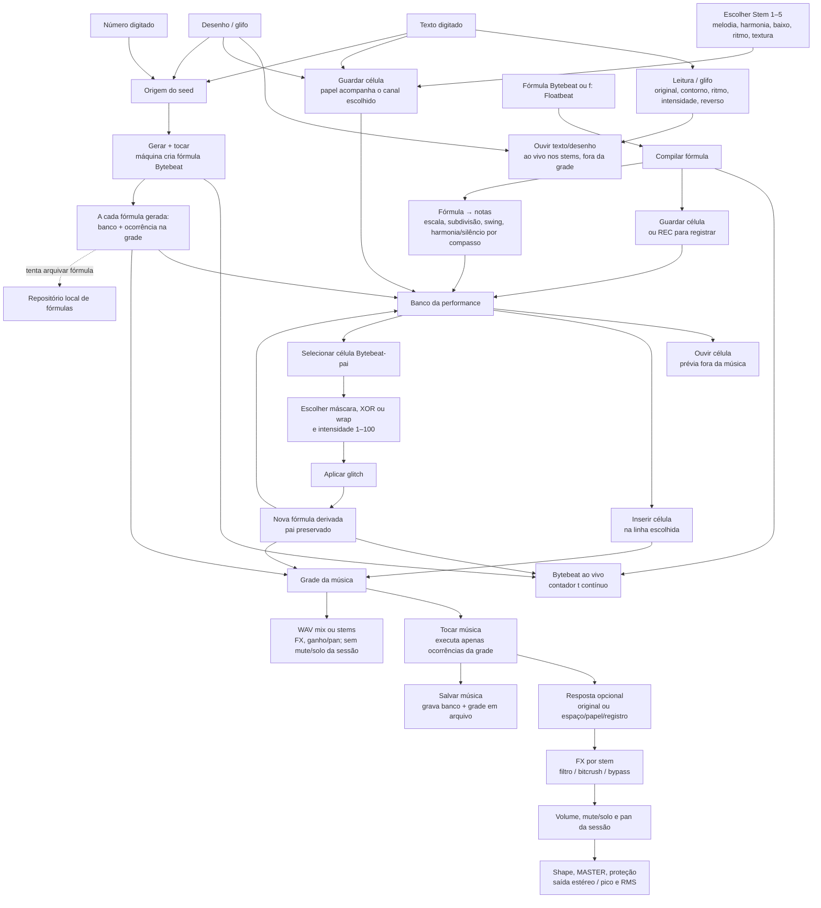

# Risco — fluxo de criação, armazenamento e reprodução

Este fluxograma separa três coisas que aparecem juntas na interface: **criar e
ouvir material**, **guardá-lo no banco da música** e **colocá-lo na grade**, que
é o que toca em Tocar música.

Versão visual pronta para abrir ou imprimir: [FLUXO_RISCO.pdf](FLUXO_RISCO.pdf).
O arquivo vetorial editável está em [resources/FLUXO_RISCO.svg](resources/FLUXO_RISCO.svg).
O diagrama abaixo incorpora o incremento V33 (20 nov. 2026); PDF/SVG ainda
representam o marco anterior e não mostram os novos menus/FX.

## Em palavras

- **Texto e desenho** produzem som ao vivo e passam pela mixagem dos stems,
  inclusive por cima da música da grade quando ela já está tocando, embora a
  entrada ao vivo ainda não seja uma ocorrência salva na grade. Com **AUTO**, melodia, baixo e
  harmonia, ritmo e textura têm camadas nos cinco canais de papéis correspondentes.
  O ritmo deriva ataques, acentos e microdesvios das notas da inscrição. O
  instrumento deriva novas leituras a cada volta. Clique direito em AUTO ajusta a força
  (40%, 70% ou 100%) e a frequência (a cada 1, 2 ou 4 voltas); clique esquerdo
  liga/desliga a geração. Ao desligar AUTO e escolher um Stem, toda a entrada
  segue esse destino e os gestos manuais prevalecem. **Alt+arraste**
  desloca um traço; **Desfazer/Refazer** percorrem até 32 edições de traço,
  deslocamento e silêncio. Pressão disponível na caneta muda dinâmica e espessura do traço; sem sensor, a posição vertical gera essa
  curva. A pressão é suavizada localmente, e traços longos simplificam pontos
  redundantes sem perder extremos, curvas e variações expressivas. O X silencia
  o traço sem apagá-lo. Guardar célula conserva a entrada no banco; Inserir célula a coloca
  na grade para tocar junto da música.
- **Texto, desenho e número como origem** alimentam a máquina de seed. O texto
  é resumido por seus bytes UTF-8, sem análise do significado; o desenho é
  resumido por seus traços. Gerar + tocar cria e toca fórmulas Bytebeat. Cada
  passo gerado é guardado no banco e ganha uma ocorrência na grade. O aplicativo
  também tenta arquivar a fórmula no repositório local.
- **Faixa completa** propõe uma peça editável nos cinco canais. Escolha
  **Por partes** para alternar conjuntos de canais ou **Contínuo** para
  preencher os cinco. A revisão indica as entradas por
  compasso e permite ouvir a proposta antes de salvar. O motivo do texto entra
  pela melodia, o do desenho entra pela textura e ambos podem voltar em outra
  pista. Na revisão, **Nova seed** cria outra proposta com o mesmo motivo e
  **Trocar A/B** alterna entre as duas para ouvir e escolher qual salvar.
  Na geração V2, o nível de surpresa transforma o retorno do motivo: médio
  espelha os intervalos; alto espelha e toca os ataques em ordem retrógrada.
  A abertura mantém o motivo original. O nível baixo preserva o retorno literal.
  Em **Retorno do motivo**, Automático segue a surpresa por padrão; se quiser,
  escolha Literal, Espelho ou Espelho + retrógrado sem alterar os outros parâmetros.
  Com **Por partes**, use **Editar partes** para marcar as pistas, mudar a
  duração, repetir o primeiro bloco e escolher a dinâmica: estável, crescente,
  decrescente ou **Arco** (cresce até o centro e recua no fim). A proposta antes
  da edição fica disponível no A/B.
  Depois de salvar e abrir uma faixa gerada em **Por partes**, use
  **Salvar → Reeditar partes da faixa salva**. O Risco recupera seed e receita
  da proveniência do projeto; **Aplicar** cria outra proposta e mantém a faixa
  aberta como comparação A/B.
  Pontuação dentro do texto abre uma pausa antes do retorno. Traços que
  sobem ou descem orientam a dinâmica do desenvolvimento.
  Use a mesma inscrição e as mesmas opções
  para repetir uma proposta a partir da seed mostrada na revisão.
- **Álbum** cria projetos editáveis em uma pasta e guarda o plano para
  retomada. Escolha **Texto atual** ou **Desenho atual** em **Origem** para
  sugerir uma seed e fazer o motivo da inscrição circular entre melodia,
  baixo e textura. A revisão mostra o canal e a transformação do retorno em
  cada faixa (literal, espelhada ou espelhada + retrógrada, conforme a surpresa).
  **Por partes** aplica a forma a cada faixa. Use **Retomar projetos** e selecione a pasta
  para continuar a criação pelo manifesto. **Renderizar WAVs** abre a pasta
  do manifesto e gera os arquivos de áudio.
- **Fórmula digitada** precisa de Compilar fórmula; Ouvir fórmula toca a
  expressão ao vivo. Guardar célula a põe no banco. Com REC armado, aplicar uma
  fórmula também a registra na performance e na grade.
- **Glitch matemático** parte de uma célula Bytebeat já guardada: selecione no
  campo de origem **Glitch: máscara**, **Glitch: XOR** ou **Glitch: wrap**;
  selecione no banco a célula que será o pai, ajuste intensidade entre 1 e 100
  e pressione **Aplicar glitch**. O Risco compila a derivação, passa a tocá-la
  diretamente e guarda uma nova célula no banco e no fim da grade, no stem
  selecionado. A célula-pai não é alterada; selecioná-la novamente permite retomar o original. Ao sair
  do modo glitch, o valor da seed numérica anterior retorna ao campo.
- **Banco** é a coleção de materiais guardados nesta música. **Grade** é a
  sequência de ocorrências que compõe a música. Uma célula no banco só toca na
  música inteira depois de ser inserida na grade. Com AUTO ativo, **Inserir
  célula** calcula uma posição e um canal de acordo com a seed, o início
  indicado, os papéis e a ocupação existente. Um clique em espaço vazio da
  grade fornece uma referência temporal e deixa AUTO decidir a pista e o tempo
  finais. Com AUTO desligado, usa o tempo e o canal manuais; se AUTO não achar
  entrada livre, não faz inserção silenciosa.
- **Ouvir célula** faz uma prévia isolada, fora da música completa. Tocar música
  executa as células que estão na grade. Salvar grava a performance (banco e
  grade) num arquivo local; Parar interrompe o áudio.
- Na grade, use a roda para percorrer a música e Ctrl+roda para zoom. O zoom
  acompanha o ponto indicado pelo cursor; novas células no fim da música
  deslocam a visualização para mostrar a ocorrência adicionada.

Atualização 2026-11-26: a grade tem cinco canais — Melodia, Harmonia, Baixo,
Ritmo e Textura. A faixa completa gera material próprio para cada um. Ritmo usa
ataques curtos; Textura sustenta notas harmônicas. Projetos antigos mantêm os
três stems que já tinham; a extensão opcional `STEM_EXTRAS` guarda os dois
canais novos.

O fluxo descreve o comportamento de V33 e as atualizações posteriores. A saída
do dispositivo é uma mixagem estéreo dos cinco canais; cada stem pode ser
exportado em WAV separado, inclusive os cinco em lote. Entrada ao vivo não entra
na grade nem é exportada até ser guardada e inserida, mas usa o mixer, pan e FX
por stem. Ouvir célula usa o stem selecionado ou o bloco selecionado.
Salvar confirma o banco/grade/parâmetros. A cópia automática separada conserva
contexto, rascunhos, prévia generativa e histórico limitado de edições;
recuperá-la não dispara áudio. Busca/favoritas/proveniência ficam no menu do
banco. O seletor de voz inclui AY · tons, estudo parcial para eventos de notas,
enquanto Bytebeat/Floatbeat diretos executam suas próprias expressões.
