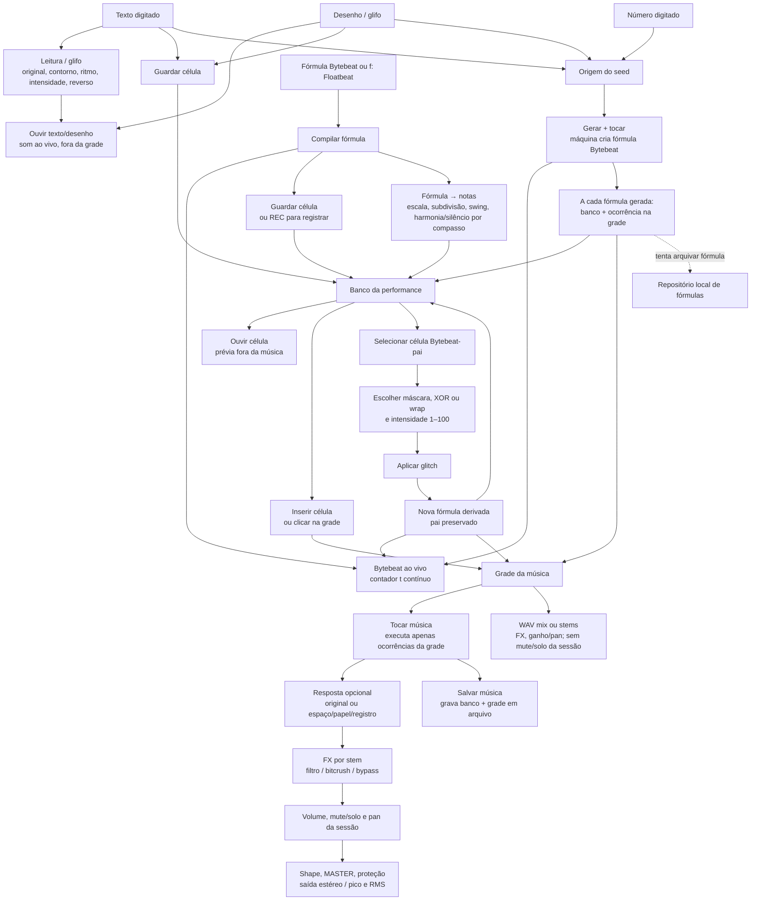

# Risco — fluxo de criação, armazenamento e reprodução

Este fluxograma separa três coisas que aparecem juntas na interface: **criar e
ouvir material**, **guardá-lo no banco da música** e **colocá-lo na grade**, que
é o que toca em Tocar música.

Versão visual pronta para abrir ou imprimir: [FLUXO_RISCO.pdf](FLUXO_RISCO.pdf).
O arquivo vetorial editável está em [resources/FLUXO_RISCO.svg](resources/FLUXO_RISCO.svg).
O diagrama abaixo incorpora o incremento V33 (20 nov. 2026); PDF/SVG ainda
representam o marco anterior e não mostram os novos menus/FX.

## Em palavras

- **Texto e desenho** podem produzir som ao vivo. Isso, por si só, não os coloca
  na grade. Guardar célula os conserva no banco da performance.
- **Texto, desenho e número como origem** alimentam a máquina de seed. O texto
  é resumido por seus bytes UTF-8, sem análise do significado; o desenho é
  resumido por seus traços. Gerar + tocar cria e toca fórmulas Bytebeat. Cada
  passo gerado é guardado no banco e ganha uma ocorrência na grade. O aplicativo
  também tenta arquivar a fórmula no repositório local.
- **Fórmula digitada** precisa de Compilar fórmula; Ouvir fórmula toca a
  expressão ao vivo. Guardar célula a põe no banco. Com REC armado, aplicar uma
  fórmula também a registra na performance e na grade.
- **Glitch matemático** parte de uma célula Bytebeat já guardada: selecione no
  campo de origem **Glitch: máscara**, **Glitch: XOR** ou **Glitch: wrap**;
  selecione no banco a célula que será o pai, ajuste intensidade entre 1 e 100
  e pressione **Aplicar glitch**. O Risco compila a derivação, passa a tocá-la
  diretamente e guarda uma nova célula no banco e no fim da grade, no stem
  selecionado. A célula-pai não é alterada; selecioná-la novamente permite retomar o original. Ao sair
  do modo glitch, o valor da seed numérica anterior retorna ao campo.
- **Banco** é a coleção de materiais guardados nesta música. **Grade** é a
  sequência de ocorrências que compõe a música. Uma célula no banco só toca na
  música inteira depois de ser inserida na grade.
- **Ouvir célula** faz uma prévia isolada, fora da música completa. Tocar música
  executa as células que estão na grade. Salvar grava a performance (banco e
  grade) num arquivo local; Parar interrompe o áudio.
- Na grade, use a roda para percorrer a música e Ctrl+roda para zoom. O zoom
  acompanha o ponto indicado pelo cursor; novas células no fim da música
  deslocam a visualização para mostrar a ocorrência adicionada.

O fluxo descreve o comportamento V33 em 2026-11-20. A saída do dispositivo é
uma mixagem estéreo das três pistas; cada stem pode ser exportado em WAV
separado, inclusive os três em lote. Fonte ao vivo fora da grade não passa
pelos FX por pista; Ouvir célula usa o stem selecionado ou o bloco selecionado.
Salvar confirma o banco/grade/parâmetros. A cópia automática separada conserva
contexto, rascunhos, prévia generativa e histórico limitado de edições;
recuperá-la não dispara áudio. Busca/favoritas/proveniência ficam no menu do
banco. O seletor de voz inclui AY · tons, estudo parcial para eventos de notas,
enquanto Bytebeat/Floatbeat diretos executam suas próprias expressões.
